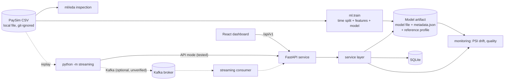

# Architecture

## Training / serving contract (the part that prevents silent skew)
- One `FeatureContract` (`ml/pipeline/features.py`) is fitted on the **training range only**, saved in the artifact, and used
  by training, the API and monitoring. Unseen transaction types go to an `__unknown__` bucket.
- Only `step, type, amount, nameOrig, nameDest` (+ `isFraud` for training) are ever read. The four balance columns and
  `isFlaggedFraud` are never loaded: PaySim cancels fraudulent transactions, so balances leak the label.
- History features (`orig_prev_*`) use strictly earlier steps. At serving time the API prepends the sender's earlier
  transactions that **it** stored, so these features reflect platform history, not the dataset's full history (known skew).
- Time split on whole `step` values: train < validation < test. Early stopping and the threshold use validation only; test is
  scored once per model, after the threshold is fixed. The model is chosen by validation PR-AUC.
- Artifacts: native `model.json` (XGBoost) or pickle-based `model.joblib` (scikit-learn), SHA-256 and library-version checked.

## Backend layers (`backend/app`)
`main.py` (thin FastAPI binding: CORS, request id, limits, error handlers, routes) → `service.py` (all behaviour) →
`validation.py` (single source of input rules) / `db.py` (SQLite, parametrised SQL, explicit transactions) /
`model_service.py` (artifact loading: `unavailable` | `invalid` | `ready`) / `ratelimit.py`. Everything below `main.py` is
framework-free and is what the tests exercise.

## Data stores
SQLite file: transactions (with score, threshold, model hash, metrics-origin label), cases + case events, analyst feedback,
rejection counters (error codes only), retraining requests + events. Uploaded CSVs are processed in memory and never stored.

## Optional components (the baseline demo needs none of them)
Kafka transport, Feast, Evidently report, MLflow tracking, XGBoost (falls back to `hist_gbm`/`logreg` only when you ask),
graph analysis. Each is imported lazily and reports a clear status when missing.

## Deliberate non-goals
No authentication/authorization, no multi-process scaling (SQLite + in-memory rate limiter), no automatic model replacement,
no GNN, no claim of real-time production streaming (replay of a local file only).
