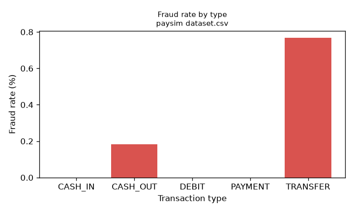
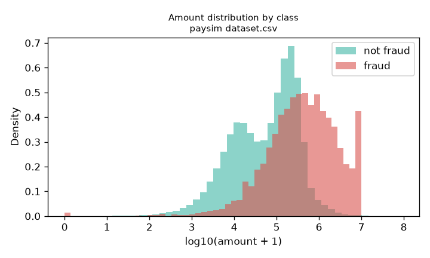
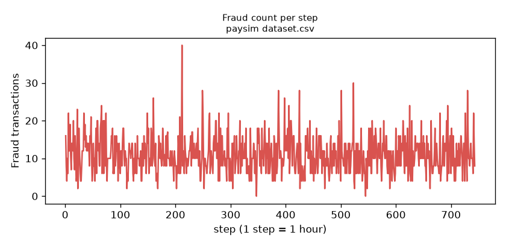
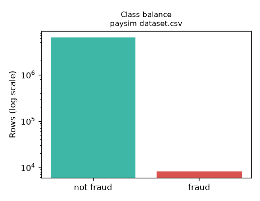

# EDA report: paysim dataset.csv

Generated by `python -m ml.eda.analyze` from the file below. Every number is computed from that file.

- File: `paysim dataset.csv` (493.5 MB), SHA-256 `16910f90577b0d981bf8ff289714510bb89bc71bff7d3f220f024e287e4eea6b`
- Rows: 6,362,620; columns: 11 (step, type, amount, nameOrig, oldbalanceOrg, newbalanceOrig, nameDest, oldbalanceDest, newbalanceDest, isFraud, isFlaggedFraud)
- Duplicated rows: 0; missing values: 0
- Fraud rows: 8,213 (0.1291%); imbalance ratio 773.7 : 1

PaySim is a **simulation** of mobile-money transactions, not real bank customer data.

## Transaction types (observed spellings)

| type | transactions | fraud | fraud rate |
|---|---|---|---|
| CASH_IN | 1,399,284 | 0 | 0.0000% |
| CASH_OUT | 2,237,500 | 4,116 | 0.1840% |
| DEBIT | 41,432 | 0 | 0.0000% |
| PAYMENT | 2,151,495 | 0 | 0.0000% |
| TRANSFER | 532,909 | 4,097 | 0.7688% |

## Amount by class

| class | count | mean | median | max |
|---|---|---|---|---|
| fraud | 8,213 | 1,467,967.30 | 441,423.44 | 10,000,000.00 |
| non_fraud | 6,354,407 | 178,197.04 | 74,684.72 | 92,445,516.64 |

## Time steps

743 distinct steps; rows per step min/median/max 2/529/51,352; fraud per step min/median/max 0/10/40; steps with zero fraud: 2.

## Balance behaviour by class

| measure | fraud | not fraud |
|---|---|---|
| origin balance before = 0 | 0.50% | 33.09% |
| amount empties origin account (known before the transaction) | 97.67% | 31.11% |
| origin balance after = 0 (post-transaction) | 98.05% | 56.68% |
| destination balance before = 0 | 65.15% | 42.48% |
| destination balance after = 0 (post-transaction) | 49.81% | 38.33% |
| origin balance error != 0 (post-transaction) | 0.55% | 79.96% |
| destination balance error != 0 (post-transaction) | 56.50% | 65.84% |
| receiver is a merchant (M…) | 0.00% | 33.86% |

## Leakage / generator-rule diagnostic

Rule: `orig_emptied AND type in {types that contain any fraud in THIS file}` (types: CASH_OUT, TRANSFER).

On this file: TP 8,022, FP 1,180,064, FN 191; precision 0.68%, recall 97.67%.

If precision and recall are both high, one pre-transaction rule explains most fraud: the data generator's pattern, not realistic difficulty. Treat any model that uses balances accordingly.

Post-transaction balances (`newbalance*` and the error terms) are not known when a transaction is scored and, in PaySim, differ systematically for fraud. The `all_balance` feature set exists only to measure how optimistic those make a model.

## Plots

## What this report does not establish

Licence/usage terms and download provenance must be recorded by you in `docs/paysim_provenance.md`. Nothing here says how a model will perform; see `docs/real_training_report.md`.
